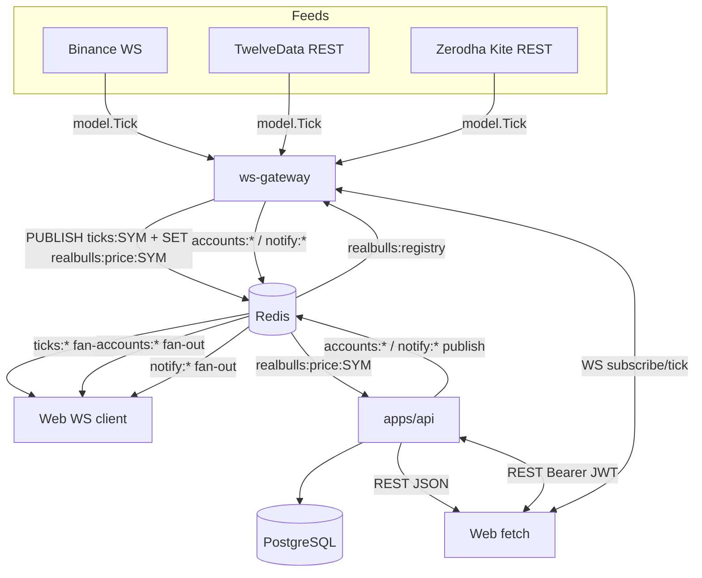
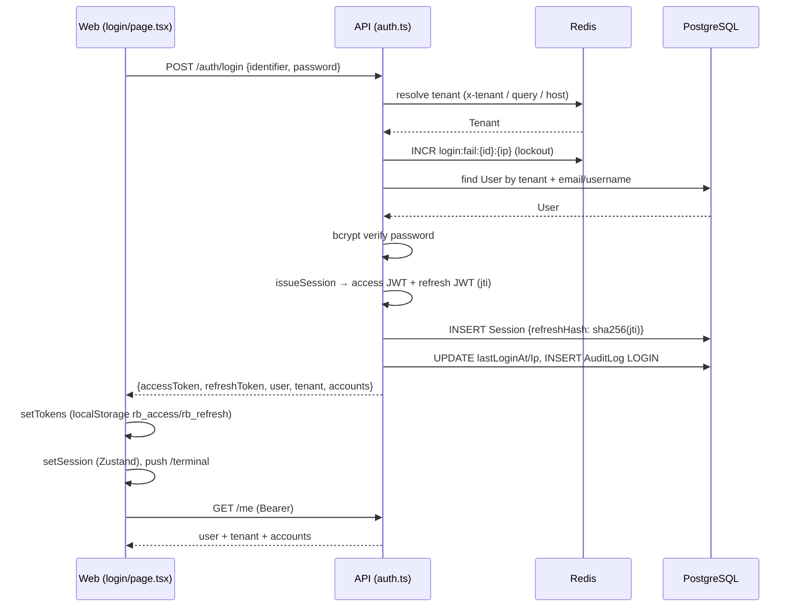
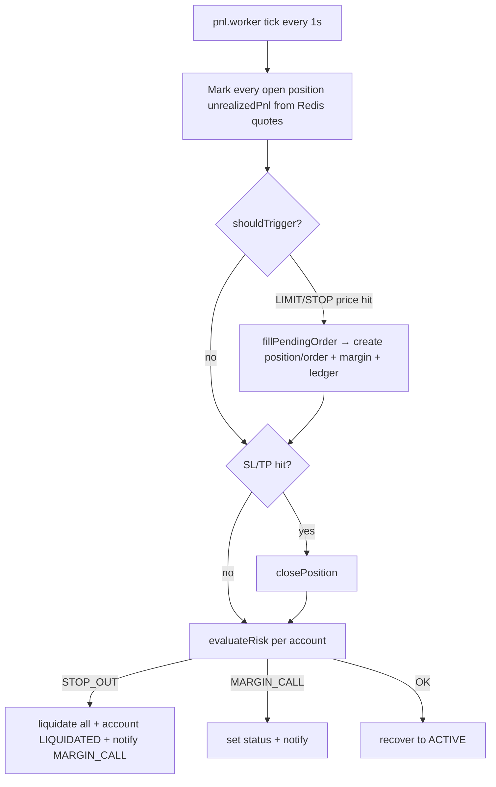

# Realbulls — Data Flow

End-to-end data flow across the monorepo: market data ingestion, order lifecycle, risk cycle, account snapshots, notifications, and the data stores.

## Component responsibilities

| Component | Language | Responsibility |
|---|---|---|
| `apps/web` | Next.js 15 | Terminal + admin + whitelabel UI; consumes REST + WS |
| `apps/api` | Node + Fastify | REST API, order/ledger engine, P&L worker |
| `apps/ws-gateway` | Go | Market-data ingest + tick fan-out |
| `packages/db` | Prisma | Schema, migrations, seed |
| `packages/engine` | TS | Pure margin/P&L/liquidation math |
| `packages/shared` | TS | Types, Zod schemas, design tokens |
| PostgreSQL | — | Primary data store |
| Redis | — | Pub/sub bus + price snapshots + registry + auth tokens |

## High-level data flow



---

## 1. Auth / login data flow



- **Tenant resolution** (`lib/tenant.ts:11`): `x-tenant` header → `?tenant=` query → `?domain=` query → `Host` header.
- **Fail-lockout** (`routes/auth.ts:84–97`): Redis key `login:fail:{identifier}:{ip}`; 8 fails → 429 for 900s.
- **JWT** (`lib/jwt.ts`): access claims `sub/tenantId/role`, HS256, TTL `env.jwtAccessTtl` (900s); refresh has `typ:"refresh"`, `jti`, TTL `env.jwtRefreshTtl` (14d).
- **API auth** (`plugins/auth.ts:14`): `authenticate` verifies bearer access JWT → `request.auth`. Tenant identity always from JWT `tenantId` on authed calls.
- **Silent refresh** (`lib/api.ts:87–110`): on 401 → `POST /auth/refresh` once (deduped), retry; failure → clear tokens + redirect `/login`.

---

## 2. Market data pipeline

### Producers (Go gateway — `cmd/gateway/main.go`)

1. `config.Load()` → env.
2. `store.New(ctx, cfg.RedisURL)` — Redis connect + ping; fatal on failure.
3. `st.WaitReady(ctx)` — 10s readiness poll.
4. `server.NewHub(st)`; `hub.RunFanout(ctx, "ticks:*", "accounts:*", "notify:*")` goroutine.
5. `feed.NewManager(st)`; conditionally add Binance / TwelveData / Kite feeds.
6. `go manager.Start(ctx)`; `server.New(hub)`; `srv.ListenAndServe(ctx, ":8080")`.

Only configured providers start. The gateway reads `realbulls:registry` for market status and symbols; there is no generated fallback feed.

### Feed adapters (`internal/feed/`)

| Adapter | Source | Transport | Spread | Notes |
|---|---|---|---|---|
| `binance.go` | Binance `bookTicker` | WebSocket `wss://stream.binance.com:9443` | none (mid only) | Reconnect backoff 1s→30s |
| `twelvedata.go` | `api.twelvedata.com/quote` | REST poll (60s, batch 30) | 5 bps | Forex/commodity/NSE |
| `kite.go` | `api.kite.trade/quote` | REST poll (30s) | 3 bps | Uses `zerodha:access_token` from Redis |

All feeds normalize to `model.Tick{Symbol, Bid, Ask, Mid, Ts}` and call `Manager.Publish` → `store.PublishTick`.

### Distribution (`internal/store/redis.go`, `internal/server/hub.go`)

`PublishTick` (32–42) pipelines a **dual-write**:
- `PUBLISH ticks:<SYMBOL>` — live pub/sub fan-out
- `SET realbulls:price:<SYMBOL> <payload>` — persistent last-price snapshot (no expiry)

`hub.RunFanout` (131–147) PSubscribes patterns `ticks:*`, `accounts:*`, `notify:*`; `dispatch` (149–160) routes by channel prefix:
- `dispatchTick` (162–177) → `{op:"tick", data}` to `bySymbol[symbol]` clients
- `dispatchAccount` (179–194) → `{op:"account"}` to `byAccount[accountID]`
- `dispatchNotify` (196–211) → `{op:"notification"}` to `byUser[userID]`
- `BroadcastAlert` (224–238) → `{op:"alert", level, message}` to all clients

### Consumers

**Web** (`lib/ws.ts`): `connect()` opens `new WebSocket(resolveWsUrl())`; on open sends `{op:"subscribe", symbols, accountId, userId}`. `handle` routes `tick` → `useMarketStore.setTick`, `account` → `useAccountStore.setSnapshot`. Reconnect with exponential backoff ≤30s. `resolveWsUrl` (`lib/api.ts:5–15`): explicit `NEXT_PUBLIC_WS_URL` or same-origin `/ws`.

**API** (`services/market.service.ts`): `getQuote` (56–66) reads `priceKey(symbol)` = `realbulls:price:<SYMBOL>`. `getExecutableQuote` (190–203) applies `quotedSpread` (markup/markdown bps). `executablePrice` (205–207) picks ask for BUY, bid for SELL.

**Candle worker** (`services/candle.worker.ts`): every 2000ms reads quotes for enabled assets and upserts `Candle` rows for M1/M5/M15/H1 (5–47). `GET /assets/:id/candles` serves them.

**Registry**: API writes `realbulls:registry` at boot; the gateway reads it for symbols and market status.

---

## 3. Order lifecycle

### Placement — `POST /orders` (`routes/trading.ts:21` → `order.service.placeOrder` at `services/order.service.ts:70`)

```mermaid
sequenceDiagram
    participant W as Web
    participant R as trading.ts
    participant O as order.service
    participant M as market.service
    participant E as engine
    participant P as PostgreSQL
    participant N as notify.service

    W->>R: POST /orders {assetId, accountId, side, type, qty, leverage, price}
    R->>O: placeOrder
    O->>O: account ownership + status
    O->>O: idempotency-key short-circuit
    O->>M: getEffectiveConfig / resolveRisk
    O->>O: isMarketOpen + derivative lot rule
    O->>E: previewOrder (margin, commission, affordability)
    E-->>O: OrderPreview
    O->>O: LIMIT → PENDING Order; STOP → set position SL
    O->>O: MARKET → slippage fill
    O->>P: Serializable tx: Position(OPEN) + Order(FILLED) + marginUsed + ledger
    O->>N: notifyAccountOwner(accountId, "FILL")
```

Key steps:
1. Validate account ownership + status (79–83); idempotency-key short-circuit returns existing order (85–97).
2. `getEffectiveConfig` (enabled/spread/commission); segment tradable; `isMarketOpen` (`lib/market-hours.ts`); derivative whole-lot rule.
3. `resolveRisk` (`market.service.ts:153`) → leverage/marginCall/stopOut (user override → tenant rule → global rule → asset maxLeverage, clamped by config).
4. `getExecutableQuote`; LIMIT price-relation validation.
5. **STOP** is special: sets the matching open position's `stopLoss` and returns `STOP_LOSS_SET` (123–138). No Order row created.
6. **LIMIT** creates a PENDING `Order` (140–158).
7. **MARKET**: `previewOrder` (`packages/engine/src/index.ts:21–72`) computes required margin, commission, free margin after, affordability, risk; insufficient → 422 `INSUFFICIENT_MARGIN`. Fill = mid ± 0.0001 slippage; `requiredMargin` + `liquidationPrice`.
8. **Serializable transaction** (193–256): create `Position` (OPEN, margin, commission, SL/TP, liquidation price); create `Order` (FILLED, filledPrice/Qty, positionId); increment `account.marginUsed`; `postLedgerChangesWithin` with `COMMISSION` debit + `MARGIN_HOLD` audit-only.
9. `notifyAccountOwner(accountId, "FILL", ...)` (258).

### Close — `closePosition` (`order.service.ts:271`)

- `realizedPnl` from engine (299–307); close commission (308); released margin pro-rata (309).
- Serializable tx updates position (CLOSED qty 0 / partial), account marginUsed, ledger `REALIZED_PNL` + `COMMISSION` + `MARGIN_RELEASE` (313–358); notify (360).
- `closeAllPositions` (364–376), `cancelOrder` (378–383).

---

## 4. Risk cycle — `runRiskCycle` (`order.service.ts:393`)



- Marks every open position's `unrealizedPnl` from Redis quotes (400–416).
- Triggers PENDING orders via `shouldTrigger` (LIMIT: ask≤price for BUY / bid≥price for SELL; STOP: ask≥trigger for BUY / bid≤trigger for SELL) (418–428, 486–502) → `fillPendingOrder` (504–563).
- Per account: SL/TP hit → `closePosition` (442–456); then `evaluateRisk` (engine) → `STOP_OUT` liquidates all + sets account `LIQUIDATED` + notify `MARGIN_CALL` (467–474); `MARGIN_CALL` sets status + notify (475–477); recovery to `ACTIVE` (478–480).

### P&L worker (`services/pnl.worker.ts`)

`tick` runs `runRiskCycle`, snapshots every non-house account (`unrealizedPnl`, `equity`, `freeMargin`, `marginLevel`), publishes `accounts:<id>`. Interval `env.pnlTickMs` (default 1000ms); Redis pub `accounts:*`.

---

## 5. Double-entry ledger — `services/ledger.service.ts`

`postLedgerChanges` / `postLedgerChangesWithin`:
1. Lock `Account` row `FOR UPDATE`.
2. Resolve the tenant's HOUSE account.
3. Write mirrored CREDIT/DEBIT entries to user + house.
4. Update balance; `entryGroupId` correlation; `auditOnly` handling (no balance movement).

Ledger rows are **immutable at the DB level** — Postgres triggers `ledger_no_update` / `ledger_no_delete` raise exceptions (`packages/db/src/applySql.ts`). Run by seed and standalone.

| Type | Balance movement | Notes |
|---|---|---|
| `DEPOSIT` / `WITHDRAWAL` / `ADJUSTMENT` | yes | Funding |
| `REALIZED_PNL` / `COMMISSION` / `SWAP` / `LIQUIDATION_FEE` | yes | Trading |
| `MARGIN_HOLD` / `MARGIN_RELEASE` | no | `auditOnly` |

Money stored as `Decimal(24,8)`, converted at API boundaries via `D.num`/`D.toMoney` (`lib/money.ts`).

---

## 6. Notifications — `services/notify.service.ts`

- `notify` creates a `Notification` row and `redis.publish("notify:"+userId, ...)` (4–12).
- `notifyAccountOwner` skips house accounts (15–19).
- Gateway fans `notify:*` to subscribed user sockets.

---

## 7. Workers summary

| Module | Responsibility | Interval / pub-sub |
|---|---|---|
| `pnl.worker.ts` | Risk cycle + account snapshots → `accounts:<id>` | `setInterval(env.pnlTickMs)` 1000ms |
| `candle.worker.ts` | M1/M5/M15/H1 candles from quotes → upsert `Candle` | `setInterval(2000)` |
| `alert.worker.ts` | Check ACTIVE `PriceAlert` vs quotes → `TRIGGERED` + notify | `setInterval(3000)` |

All in-process `setInterval` loops started in `index.ts:101–103`, stopped on SIGINT/SIGTERM (`index.ts:105–113`). No BullMQ/cron.

### Redis pub/sub channel map

| Producer | Channel | Consumer |
|---|---|---|
| gateway | `ticks:<SYMBOL>` | hub → WS clients (bySymbol) |
| pnl.worker | `accounts:<accountId>` | hub → WS clients (byAccount) |
| notify.service | `notify:<userId>` | hub → WS clients (byUser) |

**Registry**: API writes `realbulls:registry` at boot; the gateway reads it for symbols and market status.

---

## 8. WebSocket protocol (`internal/server/`)

### Endpoints (`server.go`)

- `/ws` — main WebSocket
- `/healthz` — `{status:"ok", uptimeSec}`
- `/metrics` — `{clients: hub.ClientCount()}`

### Client → server (`ClientMessage`)

```json
{ "op": "subscribe",   "symbols": ["BTCUSDT"], "accountId": "...", "userId": "..." }
{ "op": "unsubscribe", "symbols": ["BTCUSDT"], "accountId": "...", "userId": "..." }
{ "op": "ping" }
```

### Server → client (`ServerMessage`)

```json
{ "op": "welcome" }
{ "op": "tick",         "data": { "symbol": "...", "bid": ..., "ask": ..., "mid": ..., "ts": ... } }
{ "op": "account",      "data": { ...AccountSnapshot } }
{ "op": "notification", "data": { ... } }
{ "op": "alert",        "data": { "level": "...", "message": "..." } }
{ "op": "pong",         "ts": 123 }
{ "op": "error",        "message": "unknown op" }
```

### Client pumps (`client.go`)

- **readPump** (47–92): read limit 4096, pong handler resets read deadline. Parses `ClientMessage`; invalid JSON → `enqueueError "invalid message"`.
- **writePump** (94–119): ticker at `pingPeriod` (25s) sends `PingMessage`; writes `TextMessage` from send chan with `writeWait` (10s) deadline.
- **Constants** (12–18): `writeWait=10s`, `pongWait=60s`, `pingPeriod=25s`, `maxMessageSize=4096`, `sendBuffer=512`.
- `enqueue` (40–45): non-blocking send; drops if buffer full.

---

## 9. Data stores

### PostgreSQL (Prisma — `packages/db/prisma/schema.prisma`, 475 lines)

14 enums, 17 models. Key models:

| Model | Key fields |
|---|---|
| `Tenant` | unique `slug`, `domain`; colors/themeJson; `allowedSegments`; `status` |
| `User` | `tenantId`; unique `[tenantId,email]` + `[tenantId,username]`; role/status; locale; commission overrides; allowedSegments |
| `Session` | `userId`, `refreshHash`, ip/userAgent, `expiresAt`, `revokedAt` |
| `AuditLog` | tenantId/actorId, action, targetType/Id, before/after JSON, ip |
| `Account` | userId/tenantId, type, baseCurrency, balance/marginUsed Decimal(24,8), status, isPrimary, isHouse |
| `LedgerEntry` | tenantId/accountId, entryGroupId, direction, type, amount, balanceAfter, currency, refType/refId, memo (append-only) |
| `Asset` | unique symbol, name, assetClass, segment, base/quote currency, contractSize/tickSize/minQty, maxLeverage, feedSource, enabled |
| `AssetConfig` | unique `[tenantId,assetId]`; enabled, spreadMarkup/MarkdownBps, commissionPerLot/Order, min/maxLeverage |
| `LeverageRule` | nullable tenantId (null = global), scope, assetClass/assetId, maxLeverage, marginCallPct, stopOutPct, enabled |
| `UserLeverageOverride` | userId, segment/assetClass/assetId nullable, leverage |
| `Order` | tenantId/accountId/assetId, side/type, qty, price/triggerPrice/SL/TP, leverage, status, filledPrice/Qty, unique idempotencyKey, positionId |
| `Position` | tenantId/accountId/assetId, side, qty, avgEntryPrice, leverage, marginUsed, SL/TP, unrealizedPnl, realizedPnl, commission, liquidationPrice, status, openedAt/closedAt/closedPrice |
| `Watchlist` / `WatchlistItem` | user lists; unique `[watchlistId,assetId]`, sortOrder |
| `Candle` | unique `[assetId,timeframe,bucket]`, OHLCV Decimal |
| `PriceAlert` | userId/tenantId/assetId, direction, price, status, note, triggeredAt |
| `Notification` | userId/tenantId, kind, title, body, read |

`client.ts`: global-cached `PrismaClient` (survives HMR). `seed.ts`: `applySql()`, 2 tenants (`realbulls`, `bullsx`), 40 assets, global + per-tenant leverage rules, per-tenant asset configs, `ensureHouse`, 4 demo users. `applySql.ts`: immutability triggers.

### Redis keys

| Key / pattern | Written by | Read by |
|---|---|---|
| `realbulls:price:<SYMBOL>` | gateway `PublishTick` | API `getQuote` |
| `ticks:<SYMBOL>` (channel) | gateway | hub fan-out |
| `accounts:<accountId>` (channel) | API pnl.worker | hub fan-out |
| `notify:<userId>` (channel) | API notify.service | hub fan-out |
| `realbulls:registry` | API at boot | gateway symbols and market status |
| `zerodha:access_token` / `user_id` / `connected_at` | broker.ts | kite.go |
| `login:fail:{identifier}:{ip}` | auth.ts | auth.ts |

Redis is the central message bus: feeds publish ticks, the API publishes account/notification updates, and the gateway fans out to WebSocket clients via pub/sub. The gateway is stateless w.r.t. client state (all in-memory in Hub); Redis holds shared state.
